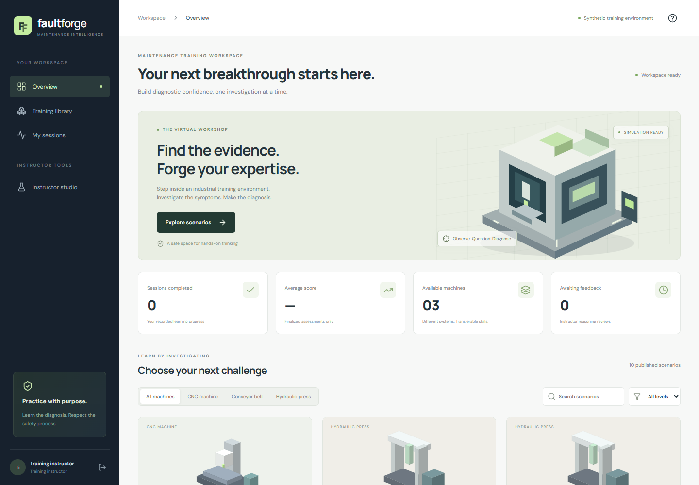

# Fault Forge — GenAI Digital Twin Training Simulator

Industrial maintenance training for CNC machines, hydraulic presses and conveyors. The current application uses clearly labeled synthetic training fixtures.

React + React Three Fiber · FastAPI · PostgreSQL · ChromaDB · configurable NVIDIA NIM inference

Grounded scenario generation, server-side validation, instructor approval, interactive diagnosis, rubric grading and PDF reports form one training workflow. Development runs with explicit synthetic providers; live inference and production qualification remain separate release gates.



## Project folders

```text
finalNVIDIA/
├── .github/                  Repository-wide automated checks
├── README.md                 Start here
├── application/              Working application
│   ├── backend/              FastAPI services, database migrations and tests
│   ├── frontend/             React interface, 3D views and browser tests
│   ├── data/                 Synthetic machine and training content
│   ├── docs/                 Technical guides and verification evidence
│   ├── tools/                Setup, checks and source packaging
│   ├── .github/              CI workflow for the application repository
│   ├── start-local.ps1       Start the local application
│   └── stop-local.ps1        Stop its local services
├── knowledge-library/       Reference collection and its supporting tools
├── documentation/           Current handover and preserved project history
│   └── history/             Earlier plans and implementation reports
└── releases/                Source packages and SHA-256 manifests
```

## Open the application

Prerequisites: Git, Node.js 24 and uv. Clone the repository, then start the application in PowerShell:

```powershell
git clone https://github.com/Dhanush191205/Fault-Forge.git
Set-Location Fault-Forge/application
.\start-local.ps1 -Install
```

For the existing computer workspace, run:

```powershell
Set-Location 'D:\Minor proj\finalNVIDIA\application'
.\start-local.ps1
```

For a new installation, use `./start-local.ps1 -Install`. Open [Fault Forge locally](http://localhost:5173) after starting it. Local account credentials are in `application/local-access.txt`; keep that file and `.env` private. Use `./stop-local.ps1` from the same folder to stop the services.

## Find what you need

- [Application setup and architecture](application/README.md)
- [Current delivery handover](documentation/FAULT-FORGE-DELIVERY.md)
- [Verification results and remaining release gates](application/docs/VERIFICATION.md)
- [Deployment guide](application/docs/DEPLOYMENT.md)
- [Strict requirements mapped to code](application/docs/STRICT-RULES.md)
- [Release packages](releases/README.md)
- [Historical documents](documentation/history/README.md)
- [Contribution and test guide](CONTRIBUTING.md)

Work on current code inside `application/`. Its location is unchanged so installed dependencies and local launchers continue to work. Runtime files and logs remain in the application's existing private/cache folders. The reference library is preserved; its contents are not automatically approved for generation.

The documents in `documentation/history/` describe earlier work and proposals. Use the current verification record above to assess this build.
