# Fault Forge

A working industrial maintenance training application: source-grounded scenario selection, deterministic validation, instructor publication, an interactive component map and 3D view, staged evidence, diagnostic assessment, human reasoning review, progress history and PDF reports.

**Current release: synthetic training pilot.** CNC, hydraulic press and conveyor fixtures contain invented readings and original project-authored reference text. They are not manufacturer-approved limits, a calibrated physics model, or a predictive-maintenance model. The original `../knowledge-library` is preserved and is **not automatically approved or uploaded to inference providers**.

## Run locally on Windows

Prerequisites: Node.js 24, `uv`, and Python 3.12 (downloaded by `uv` if needed).

```powershell
cd 'D:\Minor proj\finalNVIDIA\application'
.\start-local.ps1 -Install
```

Open **http://localhost:5173**. Unique account passwords are generated into **local-access.txt** and `.env`, both excluded from source control. The launcher starts API, worker and web processes in hidden windows. Logs and process records are in `.cache`. Stop launcher-owned processes with `./stop-local.ps1`.

1. Sign in as the instructor using `local-access.txt`.
2. Open **Instructor studio** and review any of the nine validated drafts (three machines × three levels).
3. Check the explicit review acknowledgment, then publish the reviewed version.
4. Sign out and sign in as the trainee. Enter a published simulation.
5. Review safety, inspect, read measurements, compare history, and review verification evidence.
6. Select a diagnosis, supporting observations and quiz answers. Intern/Expert also require an explanation.
7. Download the PDF or resume the session later. An instructor finalizes Intern/Expert reasoning scores.

The seed operation creates drafts only. Neither the worker nor the seed command publishes model output. Browser verification publishes fixtures through the same instructor review UI.

### Start services individually

```powershell
cd backend
uv sync --python 3.12 --extra vector
.venv/Scripts/python.exe ../tools/setup_local.py
.venv/Scripts/python.exe -m alembic upgrade head
.venv/Scripts/python.exe -m app.seed demo
.venv/Scripts/python.exe -m uvicorn app.main:app --host 127.0.0.1 --port 8000
# Separate terminal, same backend directory:
.venv/Scripts/python.exe -m app.worker
# Separate terminal, frontend directory:
npm ci
npm run dev
```

## Architecture

```mermaid
flowchart LR
  A[Versioned machine + source pack] --> B[Instructor source approval]
  B --> C[Generation admission + pinned source hashes]
  C --> D[Durable leased worker]
  D --> E[Scoped Chroma retrieval]
  E --> F[NVIDIA NIM provider + nonempty evidence]
  F --> G[Parse + component/range/citation/safety/profile checks]
  G --> H[Scenario draft + validations + private quiz]
  H --> I[Instructor reviews exact hash]
  I --> J[Published training catalog]
  J --> K[Server simulation + action history]
  K --> L[Component map / lazy R3F twin]
  K --> M[Server rubric + instructor reasoning review]
  M --> N[Dashboard + PDF]
```



Production storage is PostgreSQL with Chroma as a rebuildable index. Development explicitly uses SQLite and a fixture retriever/provider. **There is no automatic fallback between live inference and fixtures.** Provider errors leave a failed job; they never produce a fabricated successful scenario.

Generation uses a constrained selection contract. The model selects a retrieved case, approved source prose, permitted distractors and a valid difficulty profile. Novel procedures and new sensor combinations are rejected. This intentionally trades unrestricted creative variation for auditable safety and physical consistency. Self-validation by the model is recorded but never trusted as the validation authority.

| Module | Responsibility |
|---|---|
| `backend/app/rag.py` | Scoped retrieval, source snapshots, embedding adapter, Chroma index |
| `backend/app/provider.py` | NVIDIA/fixture adapters and exactly one JSON parse retry |
| `backend/app/validation.py` | Independent component, sensor, joint-state, prose, quiz and citation checks |
| `backend/app/scenarios.py` | Durable job admission, worker fencing, draft persistence and publication |
| `backend/app/simulation.py` | Ordered actions, revisions, replay and safe trainee projections |
| `backend/app/assessment.py` | Server-owned scores and immutable instructor reviews |
| `backend/app/curriculum.py` | Versioned machine/case/manual import contracts |
| `frontend/src/Twin.tsx` | Generic configuration-driven primitive rendering |

## Difficulty and grading

| Level | Hints | Distractors per question | Explanation | Scoring |
|---|---:|---:|---|---|
| Beginner | Available | 2 | Optional | Diagnosis 50 + evidence 20 + quiz 30 |
| Intern | Available | 3 | Required | Diagnosis 40 + evidence 20 + quiz 20 + instructor reasoning 20 |
| Expert | Hidden | 4 | Required | Same rubric as Intern; no hints, more alternatives |

Evidence credit penalizes irrelevant selections. Intern/Expert results remain **provisional** until an instructor assesses evidence reasoning and alternative reasoning, each 0–10. Ambiguous free text is never scored by substring matching or an uncalibrated LLM judge. The pass threshold of 70 is a project design choice, not an external qualification standard.

## Add a machine or real source material

Use a new versioned curriculum JSON pack shaped like `data/cnc-v1.json`. It contains component IDs, named sensor units with disjoint normal/abnormal envelopes, generic geometry, authorized manual text with locators, and complete cases with evidence and private grading keys. Import it in **Instructor studio → Knowledge sources**. Sources require separate review before generation. For changed content, use new IDs rather than overwriting a published version.

Existing PDFs are not blindly extracted into the model. Extract the applicable sections, retain page/section provenance, confirm rights and have an instructor complete the case contract. Numerical limits must be approved for the exact equipment revision. The fourth-machine regression test demonstrates that the engine needs no machine-specific code changes.

## NVIDIA and Chroma

Set environment values for `LLM_PROVIDER=nvidia`, `LLM_BASE_URL`, `LLM_MODEL`, `LLM_API_KEY`, `RAG_BACKEND=chroma`, embedding endpoint/model/key, and Chroma connection fields. Choose a model that fits your approved deployment; no model ID or GPU size is silently assumed. For a private deployment, terminate TLS in front of NIM and set the same OpenAI-compatible `/v1` base URL. The response contract is validated even when the provider offers structured output.

Index approved sources explicitly:

```powershell
cd backend
.venv/Scripts/python.exe -m app.seed index
```

Indexing sends source text to the configured embedding endpoint only when the source's `external_inference_allowed` flag is true. Live generation similarly checks this permission. A collection name must identify an embedding-space version; change it when model/dimensions change. Re-index source versions, validate retrieval quality, then switch collections. Cosine distance threshold `0.45` is an initial configuration, **not a measured quality guarantee**. Tune it against instructor-labeled cases.

## Deployment and verification

See [deployment guide](docs/DEPLOYMENT.md), [strict-rule matrix](docs/STRICT-RULES.md), [operations runbook](docs/OPERATIONS.md), and [verification record](docs/VERIFICATION.md).

This repository includes Docker Compose, immutable migrations, locked dependencies, GitHub Actions and Vercel frontend configuration. A deployment is not production-qualified until real NVIDIA inference, PostgreSQL/Chroma integration, representative load, approved equipment content, backup restoration and operational ownership are verified on the target environment.
