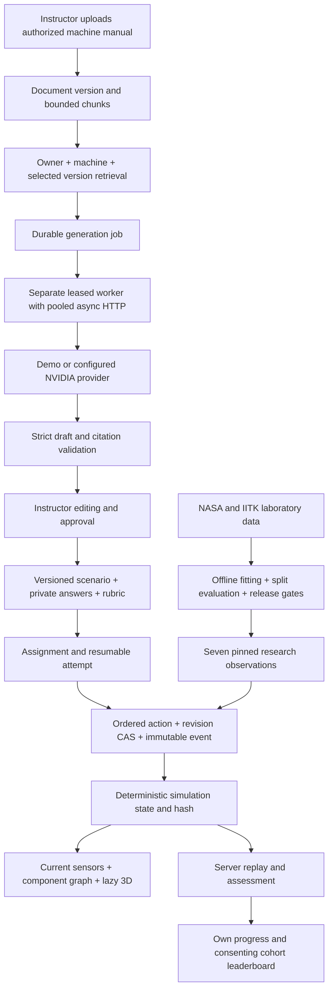

# FaultForge Twin — complete accomplishment and handover record

Updated 6 October 2026. Intended users: **new factory technicians and their instructors**. Deployment target supplied by the user: **local training pilot, up to 100 concurrent learners**. Active implementation: `application/` in the Fault-Forge workspace. This document supersedes earlier implementation-status and upgrade reports. Exact replacement code is in the application source; [blueprint.diff](blueprint.diff) provides full unified changes against the preserved original 2.0 source, and [blueprint-change-index.json](blueprint-change-index.json) lists paths, sizes and SHA-256 hashes. Generated reports, screenshots and scripts are included in that inventory; credentials, private preview databases, raw archives and model binaries are excluded.

The delivered pilot follows the supplied interface and workflow blueprint: dark navigation, searchable training cards, queued scenario generation, instructor review, five guided investigation steps, current sensors, interactive component maps and 3D views, instructor spectating, profiles, consent-based leaderboards and internal training-pack requests. It covers **Motor, CNC and Compressor: six cases per machine, 18 curated cases and 90 curated questions**. Pump and HVAC examples in the blueprint were adapted to the three machines the user explicitly selected.

Verification completed: **50 backend checks, seven Chromium browser workflows, TypeScript validation and a production frontend build**. A separate loopback HTTP benchmark completed **1,500 requests across 100 distinct authenticated learners, with zero failures and verified completed replay**. These are local SQLite pilot results. PostgreSQL deployment, GPU inference, container runtime and factory model generalization remain separate, unverified deployment gates. An absolute promise of no bottlenecks would not be supported by these measurements.

## 1. Baseline comparison and retirement

Both supplied versions were inspected before selecting `Fault-Forge-2.0-complete`. The actual code uses FastAPI, synchronous SQLAlchemy, PostgreSQL/pgvector, React and a provider adapter. The older Project-1.0 used LangChain/Pinecone; those libraries are not secretly assumed to exist in the selected backend.

| Area | Project-1.0 | Original 2.0 | Resulting decision |
|---|---|---|---|
| Identity and access | Earlier request identity and assessment boundaries required substantial repair | Server sessions, role checks, CSRF, account ownership and source consent | Extend 2.0 identity boundaries |
| Assessment history | Client transcript and streaming state were not a dependable audit record | Persisted attempts, events, hashes and revision checks | Extend the existing attempt domain |
| Answer separation | Earlier response structures exposed private answers | Public/private scenario content and stored quiz keys | Add strict nested response projections |
| Generation | Synchronous chain calls and broad fallback paths | Provider abstraction and leased queue, initially demo-focused | Durable generation in a separate worker |
| Retrieval | Equipment miss could broaden the search | Account filtering and PostgreSQL storage, but Python candidate ranking was broad | Indexed and bounded candidates with preserved filters |

The user authorized choosing the better version and deleting the other. Project-1.0 was retired only after verifying a **115-file** source/configuration/data archive. Reinstallable dependencies and caches were excluded. The archive remains at `D:/fault-forge_1.0/archives/Project-1.0-retired-2026-10-05.zip`; SHA-256 is `52bf6122d0f7c3b31041677ff68cd80b6bea08d9e9b6b6201ff82eec339935cb`. [source-retirement.json](source-retirement.json) records verification, scope and removal. Original 2.0 remains a reference at `D:/fault-forge_1.0/Fault-Forge-2.0-complete`. No old database conversion was invented. Root `architecture/` is an earlier proposal; root `product/` is an earlier pump-oriented prototype, not the active release.

## 2. Requested backend fixes

The supplied issue list contains issues 1–6 and the opening of issue 7. The remainder of issue 7 and issues 8–10 were never supplied. The work below covers the known requirements; it does not claim completion of ten unspecified fixes.

| Issue | Exact code locations | Change and rationale |
|---|---|---|
| Blocking calls in async generation | `backend/app/generation/{routes,service}.py`, `jobs/{models,service}.py`, `worker.py`, `providers/nvidia.py` | Generation validates and pins authorized sources, creates a durable job and returns 202 with its ID/status link. A separate worker awaits pooled HTTP inference with bounded timeouts/retries. Synchronous database/file handlers are regular FastAPI `def` handlers dispatched off the event loop. This remains synchronous SQLAlchemy, with asynchronous capacity admission. |
| Streaming did not persist | `training.py`, `simulation/{models,engine}.py`, migration `0006_upgrade.py` | The actual route is `/api/training/attempts/{id}/actions/stream`. It commits the same action transaction as the ordinary action route, then emits an SSE state event. Events retain attempt, sequence, action ID, server time, resulting revision/state, engine version and hash. No nonexistent original `/step/stream` route is claimed. |
| Initial-only telemetry | `simulation/engine.py`, `training.py`, `frontend/src/features/Simulator.tsx` | Each step reads the saved attempt state and checks expected revision/status before committing its deterministic transition. Current telemetry and components are returned; reload resumes saved state. Conflicting revisions return an error instead of overwriting another action. |
| Client evaluation history/time | `simulation/schemas.py`, `training.py`, `db/base.py` | Submit accepts diagnosis, quiz answers and idempotency key. Extra transcript/duration fields are rejected. Scoring replays server events, verifies state integrity and computes elapsed time from server timestamps. UTC conversion preserves aware offsets and interprets naive SQLite timestamps as UTC. |
| Answer leakage | `simulation/responses.py`, `training.py`, `generation/routes.py` | Trainee scenario, action, evidence, event and quiz DTOs use nested allowlists. Instructor/draft access requires role and ownership. Reference diagnosis and correct options stay server-side. Completed result feedback intentionally explains answers after grading. Authored prose still requires instructor review for semantic leakage. |
| Cross-equipment RAG fallback | `retrieval/routes.py`, `generation/service.py`, `documents/routes.py` | Equipment, owner, selected document IDs, readiness and pinned source versions remain in the query. Candidate count is capped at 200, result count at 20; production uses indexed lexical matching. Insufficient evidence produces an explicit failure before a live provider call. Citation IDs are checked against authorized retrieved chunks and rechecked at publication. |
| Silent vector fallback | `core/config.py`, `retrieval/routes.py`, `documents/routes.py`, `worker.py` | The selected backend has no instance-local memory-store fallback. Production retrieval is explicitly lexical. Deterministic 64-dimensional local hash vectors are enabled only by `DEMO_MODE=true`. Backend errors surface; failed semantic/vector operations are not silently replaced by a different store. Production semantic embeddings remain future work. |

Additional integrity protections include leased job ownership/expiry fencing, atomic draft plus job-success commits, transient-only provider retries, immutable action events, and PostgreSQL prevention of editing scenario definitions once used by an attempt. Multiple PostgreSQL workers claim with `FOR UPDATE SKIP LOCKED`; each worker processes one job at a time. Worker throughput was not GPU-benchmarked. Legacy simulation engines 1.0 and 2.0 remain replayable; existing hashes and histories are preserved.

## 3. Blueprint implementation and what makes it useful

| Requirement | Delivered behavior and evidence |
|---|---|
| B01 — shared navigation | FaultForge Twin navy/cyan shell; role/name/sign-out; Dashboard, generation for instructors, Leaderboard, Profile and Marketplace. Authenticated browser flows and invalid-login test pass. |
| B02 — training dashboard | Server search over public titles/machine/symptoms; equipment, difficulty and source filters; bounded pages of 24 cards; assign/start/resume/read-only preview. Catalog backend and browser checks pass. |
| B03 — scenario generation | Exactly three machines, difficulty, optional supported failure focus, selected same-machine authorized manuals, asynchronous job polling and structured instructor editing/review/publication. Separate-worker browser flow passes. |
| B04 — diagnosis and assessment | Current symptoms/evidence, diagnosis choices, private quiz keys, server grading and post-submission explanations. Each machine completes five steps, grading, reload and verified replay in browser checks. |
| B05 — component map | Selectable SVG component graph, pointer drag, pan, zoom and Fit; keyboard selection; component status is unknown before evidence. Seven compressor nodes fit the map. Backend transitions and browser interactions pass. |
| B06 — 3D and sensors | Lazy Three.js machine geometry, rotate/zoom/select, motor internal view and live/paused sensor display. Keyboard component controls remain available if WebGL is unavailable. Desktop screenshots and mobile fallback pass. |
| B07 — guided investigation | Observe symptoms at step 0; start investigation; safety review, visual inspection, condition measurement, history review and simulated repair verification. Ordered server transitions prohibit skipping. |
| B08 — instructor spectating | Owner/cohort-authorized read-only current attempt snapshots, two-second nonoverlapping polling, revision-conditional 304 responses, hidden-tab pause and request abort. Browser confirms learner steps appear in the instructor view. |
| B09 — leaderboard | SQL aggregates of recorded assessments within assigned instructor cohorts; explicit display opt-in; no email or user IDs in leaderboard rows. Privacy and profile-save checks pass. |
| B10 — profile | Own recorded started/completed counts, average grade, elapsed time, editable display name and leaderboard consent. No invented progress statistics. |
| B11 — marketplace | Internal curated training packs. Learners request lessons from an instructor already in their assigned cohort; instructors approve/decline their requests. Approval creates/reuses an assignment atomically. No payment or external messaging was inferred from the navigation label. |
| B12 — architecture flow | Scoped evidence → queued inference → validated draft → instructor review → versioned scenario → recorded actions → deterministic state → sensor/3D display and server assessment. Demo/provider-contract and end-to-end tests pass; live NVIDIA remains unverified. |
| B13 — bounded resources | Database and password-check admission, query pagination, aggregate SQL, paged CSV, generation quotas, lazy on-demand rendering and an actual 100-learner load run. Measurements below define the limit of the evidence. |
| B14 — complete handover | This report, exact source diff/inventory, requirement audit, migrations, data reports, screenshots and current check outputs. |

This is useful to new technicians because they must collect evidence in order, can resume an investigation and see how the educational state changes. Instructors approve content, control assignments, observe progress and review authoritative assessment records. Neutral initial titles and unknown component states avoid giving away the diagnosis immediately. Real-signal observations are traceable and remain separate from grading. The distinctive combination is guided training plus evidence provenance and replay, rather than an unrestricted chatbot.

The 3D scene is **simplified educational geometry**, not a validated physical digital twin or connection to a real machine. Component edges and illustrative condition indices teach relationships; they do not establish physical causality or diagnostic probabilities. Safety and repair steps review simulated evidence and do not issue physical machine-control instructions.

### Curriculum

| Machine | Six instructor reference cases |
|---|---|
| Motor | Bearing degradation; rotor imbalance; coupling misalignment; mechanical overload; cooling obstruction; phase imbalance |
| CNC | Tool wear; machining chatter; spindle bearing degradation; axis backlash; tool runout; coolant restriction |
| Compressor | Inlet-valve leak; outlet-valve leak; non-return-valve fault; piston-ring fault; native rider-belt fault; bearing fault |

Each curated case has five ordered actions and five three-option questions. Diagnosis and quiz answer positions vary deterministically. Generated drafts support 2–10 reviewed questions; the 90-question count describes the curated bank. One CNC and six compressor measurement observations attach real-data model evidence; other content is authored/simulated. The datasets do not ground all 18 diagnoses.

## 4. Architecture and module boundaries



The API is authoritative for identity, assignments, state and scoring. The generation worker is the only normal scenario inference path; slow model calls do not run in action handlers. Offline model training/extraction remains outside the API. The browser displays server state and never computes a final grade. Model predictions cannot alter rubric weights or reference answers.

Backend modules added or extended: `generation/service.py` orchestrates scoped evidence and validation; `assignments/service.py` centralizes atomic assignment reuse; `db/locks.py` provides PostgreSQL transaction advisory locks; `workspace/` owns catalog/profile/cohort/request queries; `simulation/topology.py` pins educational scene metadata; `simulation/responses.py` enforces public projections. The source inventory lists all exact changes, including tests and migrations.

Frontend responsibilities are split into typed `domain.ts`, `api/client.ts`, shell `App.tsx`, and `features/Catalog.tsx`, `Generation.tsx`, `Simulator.tsx`, `ComponentMap.tsx`, `MachineScene.tsx`, `Account.tsx`. The earlier monolithic advanced panel was replaced. Frontend source/tests/configuration were formatted. Shared API handling includes CSRF, cancellation, safe error display and empty 204/304 handling.

### Versioned schema

| Record/contract | Relevant persisted fields and invariants |
|---|---|
| User | Existing identity/role/active/session relationship; new nullable `display_name` (80 characters), `leaderboard_opt_in` default false. Profile writes are owner-only and audited. |
| Document / version / chunk | Owner, equipment, ready status, authorized usage/external inference permission, version/chunk identity. Jobs pin selected source-version IDs; untagged legacy documents are excluded. |
| Job / generation run | Request payload, source versions, prompt metadata `scenario-v3-guided`, status, lease ownership/expiry, bounded retry attempts and safe error code. Draft and success commit together. |
| Scenario version | Public objectives/symptoms/actions/citations/graph and private diagnosis/findings/transitions; publication and ownership. Curated catalog version **3** avoids rewriting earlier seeded definitions. |
| Assignment/member | Instructor, trainee membership, pinned scenario and rubric. PostgreSQL transaction locking prevents concurrent duplicate assignment creation within the shared service. |
| Training request | UUID, trainee/instructor/scenario FKs, pending/approved/declined status, nullable assignment FK, server creation time. Unique trainee+instructor+scenario; approved requires assignment, other statuses require NULL. Teacher decision locks its owned row. |
| Attempt | Assignment/trainee/scenario/rubric IDs, seed, engine version, current JSON state, revision, status, created/completed timestamps, server elapsed seconds. New attempts use engine **3.0**. |
| Attempt event | Unique attempt+sequence, action, evidence, timestamp, state revision, resulting snapshot, engine and SHA-256 state hash; immutable. Replay checks sequence, engine, revision, snapshot and hash. |
| Submission/result | Unique attempt and idempotency key, supplied diagnosis/options only; server score components and feedback. Weights remain diagnosis/evidence/quiz **50/20/30**. Elapsed time is reported, not an invented score component. |
| Component graph/state | Topology **1.1**, node ID/label/primitive/position/size/rotation and edges. Per-attempt components carry only unknown/nominal/investigate/degraded and a nullable illustrative 0–100 index. Private fault mapping is not serialized. |

Engine 3.0 begins with unknown components. Measurement can reveal investigate/degraded states; repair verification can make them nominal. The illustrative values are educational, not calibrated health percentages. Telemetry merges into current state. Old engines keep their prior behavior and hashes. Unknown/custom generated diagnoses do not fabricate known component fault mappings.

### Important API contracts

All routes require the existing session/role/CSRF boundaries as applicable. Prefixes below are actual source routes, not hypothetical replacements.

| API | Contract |
|---|---|
| `POST /api/generation/scenarios` | Instructor/admin; machine/difficulty/failure focus/document IDs/mode; 202 job ID and status URL. Owner pending/running quota defaults to 10. |
| `GET /api/jobs/{id}` | Owned job status and sanitized result/error; browser polls without overlap. |
| `GET/PUT /api/generation/drafts...`, `POST .../{id}/publish` | Owned drafts, strict five-step validation, authorized citations and instructor publication. Failure options are instructor-only. |
| `POST /api/training/assignments/{id}/attempts` | Authorized start/resume. Returns public scenario and current state/revision. |
| `POST /api/training/attempts/{id}/actions` and `/actions/stream` | Action ID and `expected_revision`; ordered CAS mutation/event commit. Stream emits committed state. |
| `GET .../{id}/events` | Authorized recorded history with replay verification, public evidence and snapshots. |
| `GET .../{id}/quiz`, `POST .../{id}/submit`, `GET .../{id}/results` | No quiz key before assessment; submission rejects transcript/duration fields; grading derives from recorded events. |
| `GET /api/workspace/catalog` | Machine/difficulty/source/search; limit defaults 24, maximum 100, offset maximum 10,000. Trainees see assignments; marketplace serves published shared packs. |
| `GET /api/workspace/scenarios/{id}/preview` | Authorized available scenario, read-only public initial state; no instructor answers. |
| `GET /api/workspace/attempts/{id}/spectate` | Only own instructor assignments; `since_revision` returns 304 if unchanged; otherwise public snapshot plus revision ETag. |
| `GET/PUT /api/workspace/profile`, `GET .../leaderboard` | Own progress/preferences; cohort-scoped consenting aggregate rankings, maximum 100. |
| `POST/GET /api/workspace/requests`, `POST .../{id}/decision` | Trainee request quota 50 pending; known active cohort instructor; unique/idempotent request, owned atomic approval/decline. Lists are paginated. |

Machine/ownership mismatches, insufficient evidence, stale revision, quota limits and unauthorized resources fail explicitly. Uploaded text is treated as untrusted evidence rather than instructions to the assistant/provider. Roles are not supplied by the trainee. The account and instructor-cohort model is implemented; organization/site tenancy, membership policies and database RLS are not present and are not claimed.

## 5. Bottlenecks found, corrected and measured

The first 100-concurrent start test exposed a real scheduling problem: 67 successful requests and **33 HTTP 500 failures**, p95 **31,067.32 ms**. [pilot-load-before.json](../evaluation/pilot-load-before.json) preserves this failed observation. Synchronous dependencies waiting inside a full database pool could occupy worker threads while handlers already holding connections waited to run. The queue/pool pattern and corrected run support that diagnosis; the old sanitized log did not capture an exact SQL exception trace.

`db/session.py` now reserves database capacity asynchronously **before** borrowing synchronous handler capacity. Session cleanup is shielded and off the event loop. Admission is one for in-memory SQLite, 15 for file SQLite (pool 5 + overflow 10), and configured PostgreSQL pool+overflow (default 8+8). PostgreSQL capacity must be budgeted across API processes and workers. This bounds concurrent database work; it is not an asynchronous ORM migration.

One factory NAT must not prevent 100 learners signing in. Login limiting now separates an account-hash key (10/minute) and IP burst (200/minute); four concurrent Argon2 checks reserve capacity before database admission. Queued password checks wait without occupying all handler/database resources. Limits are process-local; multiple API processes need a shared limiter before relying on cluster-wide rate limits.

Other controls: 10 active generation jobs per owner; one job per worker; retrieval caps; catalog/request/attempt pagination; SQL aggregates for profile/leaderboard/analytics; CSV keyset pages of 128 with sessions closed before yielding; compound indexes; no overlapping browser polling; hidden-page pause; lazy 3D, capped device pixel ratio 1.5, on-demand rendering, stable geometry reuse and disposal of GPU objects/context on unmount. Nginx configuration adds gzip for public assets, immutable hashed-asset caching, uncached index, 11 MB upload allowance for the 10 MiB application upload limit and disabled proxy buffering for stream responses. Nginx runtime was not executed here.

### Actual 100-learner HTTP result

[pilot-load-report.json](../evaluation/pilot-load-report.json) is the authoritative machine-readable result; [blueprint-load-output.txt](blueprint-load-output.txt) and [pilot-server.log](../evaluation/pilot-server.log) preserve execution evidence. Run recorded at 2026-10-06 02:23:34 UTC, Windows 11, Python 3.14.7; separate Uvicorn process, loopback HTTP, isolated file SQLite and explicit demo/testing mode. Every phase sends 100 concurrent requests. Password sign-ins use 100 distinct accounts from the same IP and obtain real sessions.

| Phase | Requests | p95 ms | Maximum ms | Failures |
|---|---:|---:|---:|---:|
| Password login | 100 | 5,778.49 | 6,002.67 | 0 |
| Start/resume | 100 | 1,872.04 | 2,335.95 | 0 |
| Catalog read rounds 1 / 2 / 3 | 300 | 887.59 / 611.29 / 592.28 | 947.24 / 675.00 / 649.59 | 0 |
| Saved-state read rounds 1 / 2 / 3 | 300 | 737.19 / 607.11 / 539.90 | 771.17 / 679.19 / 575.85 | 0 |
| Safety / visual / measurement actions | 300 | 1,528.61 / 1,715.39 / 1,561.27 | 1,776.45 / 2,188.27 / 2,150.83 | 0 |
| History / repair actions | 200 | 1,414.52 / 1,746.76 | 1,553.45 / 2,110.85 | 0 |
| Server assessment | 100 | 1,653.86 | 2,058.59 | 0 |
| Completed replay verification | 100 | 661.70 | 726.46 | 0 |
| **Total** | **1,500** | Phase-specific | Phase-specific | **0** |

All 100 attempts completed five ordered actions, submission and verified revision-6 replay. This validates a simultaneous local burst for the measured paths, not an unlimited sustained capacity claim. No latency SLO was supplied; the measured login/action delays are retained rather than hidden. The benchmark excludes PostgreSQL locks/query plans, live model calls, GPU latency and 100 simultaneous 3D browser clients. Independent browser checks use software WebGL and do not demonstrate a deployment GPU. Future capacity decisions should track request p95/p99, database wait time/pool saturation, queue age, worker retries/lease expiry, memory and disk growth on the intended host. Those metrics are recommendations, not a claim that a monitoring platform was deployed.

## 6. Real datasets and actual models

The official NASA bearing/milling and IITK compressor archives were downloaded, verified, prepared and used for CPU fitting. Source pages: [NASA PCoE repository](https://www.nasa.gov/intelligent-systems-division/discovery-and-systems-health/pcoe/pcoe-data-set-repository/) and [IIT Kanpur datasets](https://www.iitk.ac.in/iil/datasets/index.html). These are laboratory research recordings, not a live factory feed. Raw archives stay local; redistribution permission was not established. The IITK paper citation and native labels are retained in [real-data.md](real-data.md).

| Archive | Approximate size | Verified SHA-256 |
|---|---:|---|
| NASA bearing | 1.075 GB | `21001ac266c465f5d345ec42d7b508c6a6328487fd9d4d7774422dd5ea10ad83` |
| NASA milling | 14.7 MB | `bdba8d52ec1a1baab24c2be58480e6ac62508c8cc1f8219f47ebde8fc9ebc474` |
| IITK compressor | 297 MB | `0981c16a599db0c1a96bbdf77417ab61c177bde9402b08b4c421fed235244bc6` |

Preparation performs hash checks and safe extraction before fitting. Features include mean, standard deviation, RMS, absolute peak, crest factor, kurtosis, spectral entropy and four normalized band energies; CNC combines six channels and process conditions into 69 features. No compressor sampling rate or independently unverified VB unit is invented. Trusted application-generated joblib artifacts are hash-checked; user uploads cannot become model artifacts.

| Model | Actual evaluation | Serving decision |
|---|---|---|
| Motor StandardScaler + IsolationForest | First 100 experiment-2 files fit; next 50 calibrate; 256 sampled experiment-3 files held out. Held-out alert fraction **1.00**, indicating failed transfer check. | **Blocked**; prediction API returns 503. No motor real-data attachment, labeled onset accuracy or RUL claim. |
| CNC RandomForestRegressor | Four case-disjoint GroupKFold folds, 146 labeled runs out of 167; 21 missing VB excluded. MAE **0.124262749 native VB**, fold-mean baseline **0.200752065**. | Research baseline; one pinned wear observation, not evidence for every CNC fault. |
| Compressor RandomForestClassifier | 1,440 train / 360 recording holdout; byte-identical hashes cannot cross split; eight native states. Balanced accuracy **0.822222**, macro F1 **0.8208071402**. | Research baseline; six pinned held-out observations. One rig and unknown acquisition sessions limit generalization. |

[data/processed/model-evaluation.json](../data/processed/model-evaluation.json) contains exact metrics, model hashes and splits; [training-signals.json](../data/processed/training-signals.json) pins seven observations; [data-quality.ipynb](../evaluation/data-quality.ipynb) supplies executable quality checks. The CNC teaching sample predicts approximately 0.4993 versus measured VB 1.53: uncertainty is visible, rather than treating model output as truth. The bearing archive's `4th_test/txt` directory contains 6,324 files while its README describes 4,448 experiment-3 files; reconciliation is required. The compressor native `Riderbelt` label is not renamed as a verified drive-belt diagnosis. Factory validation needs acquisition/session and machine grouping, more rigs and relevant site labels.

Reproduction from `application/`, after placing the official files under `data/raw/`:

```powershell
.venv/Scripts/python.exe evaluation/prepare_real_data.py
.venv/Scripts/python.exe evaluation/train_real_models.py
```

The verified archive identities and model versions deliberately fail closed when changed. Native Windows tar with RAR support was used for NASA nested archives. Training is offline; it does not block API requests. Processed metadata is retained in the source package; raw files/model binaries are Git-ignored and must be prepared or mounted separately on another host.

## 7. Verification evidence

| Check | Current result / saved evidence |
|---|---|
| Backend behavior/security | **50 passed**, one Starlette TestClient/httpx deprecation warning; [blueprint-backend-test-output.txt](blueprint-backend-test-output.txt). Covers jobs/source scopes/leases, event immutability/replay/revision conflicts, projections, model hashes/release blocks, requests, profile/cohort privacy, guided components, legacy replay and UTC offsets. |
| Browser workflows | **7 passed**; [blueprint-browser-test-output.txt](blueprint-browser-test-output.txt). Three machine investigations, separate-worker upload/generation/review/publish, request approval/spectating, invalid login, mobile/WebGL failure fallback. Graph drag/fit, paused readings and motor internals are exercised. |
| Build | TypeScript and Vite pass; [blueprint-frontend-build-output.txt](blueprint-frontend-build-output.txt). Main JS 262.52 kB / 79.93 kB gzip; optional lazy scene 561.07 kB / 139.71 kB gzip. Vite warns that the optional scene chunk exceeds 500 kB; it is not hidden. |
| Seed acceptance | [blueprint-seed-evaluation.json](../evaluation/blueprint-seed-evaluation.json): 18 cases, 90 questions, three machines, schema-valid rate 1.0, duplicate-prompt rate 0.0. This is fixture acceptance, not an AI accuracy benchmark. |
| Dependencies | `pip check` passed; [blueprint-npm-audit.json](blueprint-npm-audit.json) reports zero vulnerabilities at audit time. The source-map-js advisory was resolved by lock update to 1.2.2. Future audit results can change. |
| Migration compilation | [blueprint-migrations.sql](blueprint-migrations.sql) contains successfully generated PostgreSQL offline SQL through 0007; execution on PostgreSQL was not tested. |
| Data quality/models | Actual archive checks, preparation, CPU fitting, evaluated splits and notebook checks completed; blocked motor gate enforced. |
| Local load | 100 distinct learners, 1,500 requests, zero failures, integrity passed, as scoped above. |

Screenshots show actual browser-rendered interfaces: [Motor](twin-motor.png), [CNC](twin-cnc.png), [Compressor](twin-compressor.png), [mobile fallback](twin-mobile.png). Browser console WebGL creation error in the fallback test is expected because that test deliberately disables WebGL. The separate FastAPI TestClient warning is a future tooling migration item; it did not fail the suite.

Run checks from `application/`:

```powershell
$env:PYTHONPATH = 'backend'
.venv/Scripts/python.exe -m pytest backend/tests -q
.venv/Scripts/python.exe evaluation/run_evaluation.py
.venv/Scripts/python.exe evaluation/pilot_load.py
cd frontend
npm run build
npm run test:e2e
```

Playwright Chromium must be installed (`npx playwright install chromium`). E2E servers use isolated ports 8002 and 5180 and temporary data; normal preview uses 8000 and 5173. Load checks create their own temporary test data/server. Model fitting was not needlessly repeated for frontend changes.

## 8. Migrations, dependencies and configuration

Current Alembic head is **0007**. Existing installations must back up the database and verify the existing Compose project/volume before migration. A new project name can select a different volume; do not interpret an empty database as lost records or delete the old volume. Source retirement did not delete any database volume.

Prior upgrade migration **0006** adds generation payload/source support, document equipment/index, chunk GIN full-text index, unique generation-run/job link, attempt completion/elapsed fields, event revision/snapshot/engine and PostgreSQL immutability triggers. New **0007_blueprint.py** adds profile preferences and training_requests, its FKs/unique/check constraints and individual indexes, plus compound catalog/job-claim/trainee-attempt/instructor-request indexes. Readiness and verification scripts expect 0007. Offline SQL is a review artifact, not proof of PostgreSQL execution. Index creation may hold write locks; plan migration time using actual table sizes.

Legacy documents with NULL equipment must be correctly reimported/tagged before use. Old three-step generated drafts must be regenerated to satisfy the strict five-step contract. Old unsupported shared catalog versions are unpublished; existing attempt references and histories remain. Version-3 seeding creates new definitions rather than mutating used ones. Old missing event fields stay NULL instead of fabricating audit history. Downgrading does not automatically republish retired cases or convert an old Project-1.0 database.

Backend packages are pinned in `requirements.lock.txt`, including NumPy/SciPy/scikit-learn/joblib/py7zr research tooling and runtime dependencies. Verified interpreter here: Python 3.14.7; supplied image targets Python 3.12.12 but was not built here. No Celery, Redis, LangChain or Pinecone was added. New frontend dependencies: Three.js **0.186.1**, typings **0.186.0**, dev formatter Prettier **3.9.9**; source-map-js lock **1.2.2**. Existing React/Vite/TypeScript/Playwright versions are recorded exactly in package.json/package-lock.json.

| Setting | Current default / use |
|---|---|
| `DEMO_MODE` | False in application settings; explicit true for educational local preview. Demo provider/hash vectors must not be silently enabled in production. |
| `WORKER_LEASE_SECONDS` | 180; allowed 120–600. Must exceed bounded inference/retry duration. |
| `DB_POOL_SIZE`, `DB_MAX_OVERFLOW` | 8 and 8, each bounded to 32; PostgreSQL per-process pool capacity. Budget all processes against server connections. |
| `MAX_PASSWORD_CHECKS` | 4; allowed 1–8. Argon2 resource admission before DB admission. |
| `MAX_OWNER_GENERATION_JOBS` | 10; allowed 1–100. Pending/running generation quota, PostgreSQL owner transaction lock. |
| `MODEL_ARTIFACT_DIR` | `./data/models`, Compose `/data/models`; trusted artifact root. Missing artifacts leave educational cases simulated. |
| `PROVIDER_MODE`, `MODEL_ID`, `PROVIDER_BASE_URL`, `NVIDIA_API_KEY` | Existing explicit provider configuration. Hosted origin restricted to `https://integrate.api.nvidia.com/v1`; local mode restricted to loopback HTTP with explicit port. |
| `DATABASE_URL`, `POSTGRES_PASSWORD` | Existing secret connection configuration; no secrets are included in this report or diff. Production rejects SQLite unless explicit testing mode. |
| `COOKIE_SECURE`, `ALLOWED_ORIGINS` | Configure HTTPS/secure cookies and approved frontend origins for deployment. Example loopback origins are not a production TLS setup. |
| `MAX_UPLOAD_BYTES` | 10 MiB application default; validation bounded up to 50 MiB. Proxy currently allows 11 MB for multipart overhead at default. Align proxy if raising upload limit. |
| `WEB_BIND_ADDRESS` | New Compose web binding defaults to `127.0.0.1`; explicit approved LAN binding is needed for real multi-device access. |
| `DEV_DEMO_PASSWORD`, `DEV_DEMO_PORT` | Preview-only, password has no default (12–128 characters); port defaults 8000. Demo account passwords reset to the supplied value at preview startup. |
| `VITE_PORT`, `FAULTFORGE_API_PROXY` | Local frontend helper settings; defaults 5173 / loopback API8000; isolated browser checks override them. |

Worker HTTP client has 30-second timeout, maximum 10 connections/five keepalive, and disables inherited environment proxies. Transient retries are bounded; invalid model JSON or ownership/citation errors do not silently fabricate a success. These defaults are conservative pilot bounds, not tuned GPU throughput claims.

### Local preview and deployment

```powershell
python -m venv .venv
.venv/Scripts/python.exe -m pip install -r requirements.lock.txt
$env:DEV_DEMO_PASSWORD = 'choose-a-local-password-at-least-12-characters'
.venv/Scripts/python.exe scripts/local_demo.py
```

In another terminal, run `npm ci` and `npm run dev` in `frontend/`, then open `http://127.0.0.1:5173`. Preview accounts are admin/instructor/trainee@example.com, all using the supplied local password. The preview starts a separate worker and persists demo history in `.local-demo/`. It adds missing preview preference columns without changing production migration policy. SQLite preview health is not production migration readiness.

For the supplied PostgreSQL stack, Docker is required:

```powershell
./START-FAULT-FORGE.ps1
./VERIFY-FAULT-FORGE.ps1
docker compose exec api python -m app.cli create-admin
```

The startup helper is explicitly a demo convenience. Production must use explicit non-demo settings, a backed-up/migrated PostgreSQL database, authorized provider configuration, TLS/secure cookies and approved origins. No Docker or PostgreSQL runtime is installed here, so container builds, SQL transaction concurrency, query plans, pgvector/full-text execution and proxy runtime must be verified on that stack. PostgreSQL advisory locks, row locking and SKIP LOCKED are implemented and compiled but SQLite does not prove their runtime semantics. For 100 machines on a factory LAN, deploy the web/API on a reachable approved host; the loopback preview itself cannot serve other devices.

## 9. NVIDIA integration and future hardware work

The existing hosted NVIDIA adapter is integrated with pooled asynchronous worker calls, strict JSON/schema/citation validation and consented sources. Provider mocks and the demo path were tested; no real NVIDIA credential, GPU execution or live-model latency result is claimed.

For self-hosted **NIM**, select the model and a supported profile for the actual GPU using the image's `list-model-profiles` output. Record the exact profile ID, engine, precision, GPU memory and model version; do not guess a GPU requirement from the current CPU forests. [NIM profile selection](https://docs.nvidia.com/nim/large-language-models/latest/deployment/model-profiles-and-selection.html) documents hardware/profile constraints. Current local-provider allowlisting accepts only loopback HTTP, so a NIM container hostname is not automatically accepted: use a verified shared host/network namespace or approved tunnel, or deliberately implement and review a new allowlist before deployment.

For semantic RAG, use a chosen versioned [NeMo Retriever embedding model](https://docs.nvidia.com/nim/nemo-retriever/embedding/latest/overview.html). Migrate storage dimensions from the demo's fixed 64 dimensions, encode documents and queries consistently, rebuild indexes and calibrate evidence thresholds while retaining all owner/equipment/source-version filters. Do not describe the current lexical path as neural semantic retrieval.

For future validated neural signal models, evaluate [Triton dynamic batching and queue controls](https://docs.nvidia.com/deeplearning/triton-inference-server/user-guide/docs/user_guide/batcher.html), numerical parity, p95/p99 latency, throughput and memory at the intended load. Use the [TensorRT support matrix](https://docs.nvidia.com/deeplearning/tensorrt/latest/getting-started/support-matrix.html) before exporting a supported neural graph. The current scikit-learn forests and IsolationForest have not been converted to TensorRT or GPU-accelerated. Keep authoritative simulation/assessment deterministic even when model output changes. CUDA/GPU batching is conditional future work, not a new requirement for this local CPU pilot.

Official NVIDIA links were checked during this upgrade. Exact model/profile availability must be rechecked on the deployment image. Real source consent and instructor approval remain required with hosted inference; uploading a manual does not authorize unrelated external sharing.

## 10. Coursera domain learning and remaining scope

The requested learning path is delivered in [coursera-learning-path.md](coursera-learning-path.md): Machine Learning Specialization (Stanford/DeepLearning.AI), Generative AI with Large Language Models (DeepLearning.AI/AWS), then Production Machine Learning Systems (Google Cloud). Official pages were checked on 5 October 2026. Project exercises connect each course to actual grouped evaluation, grounded drafts and model packaging. These are course completion credentials, not certification that FaultForge or a technician is qualified for industrial work.

The local blueprint implementation and handover are complete at the verified pilot scope. Remaining deployment/expansion work is explicit: run PostgreSQL/Compose/proxy migration checks; validate live model configuration and hardware; establish organization-level tenancy if required; gather instructor curriculum approval and factory/session-independent model data; reconcile the bearing archive and failed transfer before releasing motor inference; test intended LAN/browser hardware and sustained mixed load against agreed latency targets. No publishing, GitHub PR, push, external message, factory connection or commercial transaction was requested or performed.

Use this document together with the exact diff, source index, requirement audit and saved results for review. Historical baseline/upgrade files remain as reference and are labeled superseded so their old counts and migration heads are not mistaken for current instructions.
