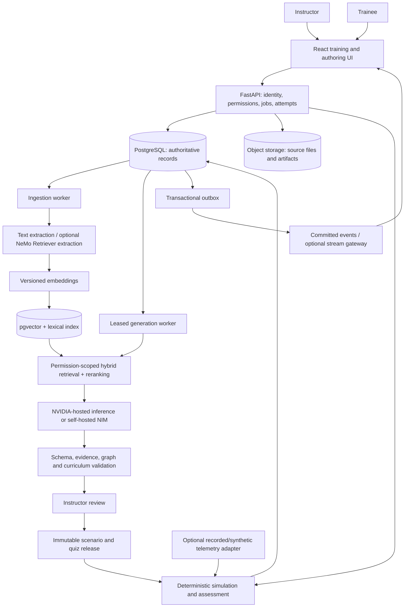

# PS015 — FaultForge: GenAI maintenance training simulator

Architecture proposal • 6 October 2026 • Status: design, not deployed implementation

Companion specifications: [data model](PS015-DATA-MODEL.md) and [start-to-finish prototype plan](PS015-PROTOTYPE-PLAN.md).

## 1. Executive decision and scope

Build an evidence-grounded scenario authoring system coupled to a deterministic training simulator. Instructors select equipment, competencies, difficulty and approved sources; GenAI proposes a failure scenario and quiz; validation and instructor approval produce an immutable release. Trainees investigate that release through simulated observations and actions. The server records actions, advances machine state, and grades against a pinned rubric.

Treat RTD here as real-time training state and optional detection/data integration. PS015 does not identify RTD as a particular NVIDIA product. The core deliverable is the scenario generator and quiz bank. Live plant integration and a physically calibrated digital twin are separate extensions.

Use FastAPI, React/TypeScript, PostgreSQL with pgvector, object storage, a durable job worker, and a replaceable NVIDIA inference provider. Start with a modular application plus separate inference/ingestion workers. Introduce additional distributed services when measurements justify them.

The first operational target is 100 concurrent learners, inherited as a planning assumption from the supplied handover. Begin curriculum validation with one motor case, then cover Motor, CNC and Compressor. GPU generation concurrency is independently limited; 100 learners do not imply 100 simultaneous LLM calls.

## 2. What could actually be inspected

The current workspace contains only [PROJECT-ACCOMPLISHMENTS.md](PROJECT-ACCOMPLISHMENTS.md). It describes a FastAPI/synchronous SQLAlchemy/PostgreSQL/pgvector/React implementation and references application source, migrations and results that are absent here. The specifically referenced original directory was also unavailable. Consequently this is a document-based architecture review, not a verified code, SQL or query-plan audit.

The record reports 18 curated scenarios, 90 questions, versioned training events, 50 backend checks, seven browser workflows and a 1,500-request/100-learner SQLite burst test. Those are historical reported results, not tests rerun for this proposal. No current PostgreSQL, container or GPU capacity claim follows from them.

### Preserve these reported foundations

- Separate durable generation jobs with lease ownership and bounded retries.
- Private reference answers and nested public response projections.
- Pinned scenario/rubric/engine versions and authoritative action history.
- Compare-and-swap revisions, server grading and replay verification.
- Source ownership, equipment filtering, explicit inference consent and instructor publication.
- Explicit failures when evidence or model prerequisites are missing.

### Bottlenecks and gaps

| Priority | Evidence from the handover | Consequence | Recommended change and verification |
|---|---|---|---|
| P0 | PostgreSQL migrations compiled but never executed in that environment | Locks, SQL behavior and indexes remain unverified | Restore into disposable PostgreSQL; execute migrations; test concurrency and inspect query plans |
| P0 | Account/cohort scope exists; organization/site membership and RLS are absent | Multi-factory isolation cannot be assumed | Add organization membership, site grants, composite tenant foreign keys, RLS and negative authorization tests |
| P0 | Provider mocks tested; live NVIDIA serving unverified | Structured-output reliability, cost and throughput unknown | Run a frozen scenario benchmark against a pinned provider/profile; retain raw validation outcomes |
| P1 | Production retrieval is lexical; 64-dimensional hash vectors are demo-only | Synonyms and paraphrases may miss relevant manual passages | Add versioned semantic embeddings, hybrid retrieval and reranking; compare against existing lexical baseline |
| P1 | Rate limits are process-local | API replicas multiply effective limits | Shared atomic limiter; durable database generation quotas; distinguish learner and authoring admission |
| P1 | One generation job per worker | Authoring queues can grow independently of learner traffic | Measure service time and queue age; add bounded workers matched to inference capacity |
| P1 | Every event stores resulting state | Storage and replay cost grow with event count/state size | Keep simple full snapshots for pilot; later introduce versioned checkpoints plus deltas without rewriting old logs |
| P1 | Spectating polls every two seconds | Large classes create avoidable read traffic | Keep conditional polling for pilot; add committed-event SSE fan-out and reconnect replay when measured |
| P1 | Reported SQLite action p95 about 1.4–1.75 seconds; login p95 about 5.8 seconds | Existing burst results do not meet the proposed interaction targets | Profile admission wait, password hashing, transactions and query latency on the target deployment |
| P1 | Motor detector failed transfer; CNC/compressor results are limited research baselines | Plausible-looking model output may be mistaken for reliable machine diagnosis | Keep failed model blocked; attach provenance and quality gates to every model release |

Do not infer that synchronous SQLAlchemy is itself a defect. Short transactions and bounded admission can be adequate. Consider an async database stack only after profiling and regression testing; never hold a database connection during remote inference.

## 3. Proposed architecture



**Authoring path:** upload → quarantine/parse → immutable document version → chunks/embeddings → scoped retrieval → generation → validation → instructor review → publication.

**Interaction path:** authenticate → authorize assignment → validate action/revision → deterministic transition → atomically commit event/state/outbox → return the public state. LLM inference is absent from this path.

**Assessment path:** freeze submission → verify/replay persisted events → apply the pinned rubric and answer keys → persist an idempotent result → release configured feedback.

**Optional data path:** read-only recorded data or approved sensor ingestion → validate time/units/quality → compute features → versioned detector → attach an observation to a scenario. Detection output is evidence with uncertainty; it cannot silently redefine ground truth or grading.

### Responsibility boundaries

| Module | Owns | Interface |
|---|---|---|
| Identity and tenancy | Organizations, site grants, roles, sessions, audit | Authorized principal, never a client-selected effective tenant |
| Knowledge | Source rights, versions, chunks, extraction and indexing | Search request with mandatory scope; evidence bundle with stable IDs |
| Authoring | Generation jobs, prompts, drafts, validation, review | Structured draft and review decision |
| Curriculum | Equipment taxonomy, competencies, failure cases, rubric and quiz releases | Immutable published release |
| Simulation | Scenario graph, action rules, seeded state, snapshots | Transition function: state + action + permitted observation → new state |
| Assessment | Private keys, event verification, scoring | Versioned assessment result and post-submission explanation |
| Models | Serving adapter, artifacts, evaluations, deployment identity | Generate/embed/rerank/predict contracts |
| Operations | Outbox, worker leases, traces, quotas, exports | Job/event status and operational metrics |

Keep these as packages in the first application. Separate process boundaries only for long-running work and independent resource scaling.

## 4. GenAI design and realism

### Grounded generation

1. Resolve the instructor's organization, site, equipment model and approved source versions on the server. A shared equipment type is insufficient when manuals describe different models or revisions.
2. Retrieve a bounded lexical and semantic candidate set using the same authorization filters. Start experimentation with 40 candidates from each path, deduplicate, fuse ranks and rerank to 6–10 passages. These are tuning defaults, not validated optima.
3. Pin all retrieved chunk IDs, source versions, retrieval configuration and embedding version in a generation evidence bundle. Refuse generation when required evidence is missing.
4. Ask the LLM for a constrained object containing public brief, private fault hypothesis, allowed evidence, action graph, quiz and citation references. Use structured output when the selected endpoint supports it; always validate on the server.
5. Validate shape, bounds, citations, state transitions, unit consistency, equipment compatibility and rubric links. A citation ID must resolve to the authorized evidence bundle; its presence alone does not prove the claim is supported.
6. Check claim support and accidental answer disclosure with reviewer assistance, then have an instructor approve the exact content hash. Any substantive edit invalidates that approval.
7. Persist a new immutable release. A released attempt never changes when the prompt, model, manual or instructor draft changes later.

Retrieved manuals are untrusted data. Text inside them cannot change system instructions, permissions, endpoints or tool choices. Inference workers should expose only the narrowly required provider operations.

### Domain realism

Define a failure case as equipment applicability, observed symptoms, competing explanations, required distinguishing evidence, permitted actions, expected transitions and reviewable sources. Vary symptoms, severity, initial conditions and distractors inside an approved template. The deterministic engine enforces the consequences of actions.

For example, an instructor-only motor case may target bearing degradation. The trainee sees “Abnormal vibration during operation,” available inspection steps and simulated readings. Similar symptoms can support imbalance or misalignment; the evidence collected during the case must distinguish them. The initial title, component colors, citations and question wording must not reveal the private diagnosis.

Start with the existing five guided stages: safety review, visual inspection, condition measurement, history review and simulated repair verification. For later branching, require reachable terminal states, bounded loops, evidence prerequisites and plausible alternative paths. Never execute Python, SQL or arbitrary expressions emitted by the model; use a small validated transition language.

The browser's 3D view renders approved component state. Attractive geometry or generated imagery does not establish physical accuracy. A calibrated physical model requires separate machine-specific equations, parameter identification, validation data and domain review.

### Quiz bank and assessment

Store stable question identities separately from immutable question versions. Each question links to one or more competencies, a difficulty level, supported equipment, private answer key, explanation and source evidence. Supported initial types: single-choice, ordering and short diagnosis selection. Add free-text scoring only with an explicit rubric and review path.

For every released single-choice question require exactly one valid answer, plausible distractors, a supported explanation and an ambiguity review. Randomize display order per attempt and persist the option-ID mapping. Do not grade by display position.

Use a quiz blueprint to select questions by competency and difficulty, then freeze the selected versions in the attempt. Track question exposure to prevent easy memorization. A practice mode may reveal explanations immediately; an assessment mode waits until the configured submission/release condition.

Retain the documented 50/20/30 diagnosis/evidence/quiz weights for compatibility, in a versioned rubric whose weights total 100. Future rubrics may add an instructor-approved safety gate. A changed rubric affects new assignments only. The LLM may suggest feedback text; the deterministic scorer owns marks and pass/fail.

## 5. NVIDIA and Hugging Face integration

| Technology | Recommended use | Adoption point |
|---|---|---|
| NVIDIA-hosted inference | Quick real-model prototype through the existing provider abstraction, using only sources permitted for external inference | First model-backed vertical slice |
| NVIDIA NIM | Self-hosted model serving with an explicitly compatible image/model/hardware profile | Pilot requiring local data processing or dedicated serving |
| NeMo Retriever | Embeddings and reranking; extraction for scanned, table-heavy or diagram-heavy manuals | Add semantic retrieval first; multimodal extraction when the corpus warrants it |
| TensorRT-LLM | Supported LLM serving backend with measured precision/batching/cache configuration | Optimize a compatible model/profile after establishing a quality baseline |
| TensorRT + Triton | Serve a validated neural signal model; tune stateless batching within latency budget | Optional detection extension |
| CUDA / GPU array operations | Batched FFT/features or large preprocessing workloads when measured faster end to end | Data volumes large enough to amortize transfers |
| NVIDIA Dynamo | Distributed inference routing and optional prefill/decode separation | Multiple serving replicas/GPUs with demonstrated queueing or utilization issues |
| Omniverse / OpenUSD | Future richer industrial scenes and asset integration | Only after the training workflow and scenario correctness are validated |

[NVIDIA's RAG Blueprint](https://github.com/NVIDIA-AI-Blueprints/rag) is a reference for ingestion, retrieval, reranking and serving integration. Adapt its component patterns while keeping assessment permissions and simulation logic in the application. Deploying its entire stack is not a prerequisite for this prototype.

[NIM model profiles](https://docs.nvidia.com/nim/large-language-models/latest/deployment/model-profiles-and-selection.html) specify the backend, precision and parallelism. Run `list-model-profiles` on the selected pinned image and actual host; record the exact profile ID. NIM does not imply that TensorRT-LLM is always the selected backend. Verify JSON output, quantization, caching and batching support for the exact model/profile.

Candidate evaluation models are [NVIDIA Nemotron Nano 9B v2](https://huggingface.co/nvidia/NVIDIA-Nemotron-Nano-9B-v2) and [Qwen3-8B](https://huggingface.co/Qwen/Qwen3-8B). Their existence was checked through the Hugging Face connector. They are candidates, not a claim of best quality or NIM availability on an unspecified GPU. Pin model/tokenizer revisions; record governing terms; review any remote model code before enabling it. Compare structured-output success, expert acceptance, evidence support, latency and cost per approved scenario. Begin with bounded output and non-reasoning mode where supported, then compare quality.

GPU memory planning must include weights, runtime workspaces, activations, attention KV or architecture-specific recurrent state, and concurrent requests. For illustration, 8 billion BF16 parameters alone occupy about 16 GB in decimal units; this is not a total serving-memory estimate. A 24 GB card may or may not fit the chosen deployment. Do not buy hardware or promise concurrency from parameter count alone. Host embedding/reranking remotely or schedule them separately if local GPU memory is constrained.

[Triton's dynamic batcher](https://docs.nvidia.com/deeplearning/triton-inference-server/user-guide/docs/user_guide/batcher.html) is suitable for stateless model requests. Start without intentional queue delay and add delay only when measured throughput improves inside the response budget. LLM continuous batching is a backend-specific concern, distinct from batching arbitrary training-session transitions.

[TensorRT compatibility](https://docs.nvidia.com/deeplearning/tensorrt/latest/getting-started/support-matrix.html) depends on runtime, platform and hardware. Keep the reported scikit-learn forests on their validated CPU path; they are not automatically TensorRT models. A future ONNX/TensorRT neural detector must pass numerical and task-quality parity checks after export and quantization.

[Dynamo](https://docs.nvidia.com/dynamo/dev/design-docs/overall-architecture) provides distributed serving capabilities. It is a scale-out option, not a required layer for a single serving instance.

The live [NVIDIA skills catalog](https://github.com/NVIDIA/skills/blob/main/skills.sh.json) was checked through GitHub after the catalog CLI could not reach npm. For a later RAG Blueprint deployment, the `rag-blueprint` skill is a relevant optional helper. First useful prompt: “Configure a text-only RAG deployment using my approved model profile and machine-scoped metadata filters.” Optional installation command, not executed:

```text
npx skills add nvidia/skills --skill rag-blueprint --agent codex --global --yes
```

## 6. Performance and scale design

### Independent workloads

**Learner state:** prioritize short transactions and predictable response times. Use stateless API replicas, a bounded connection pool, per-attempt revision checks and current-state snapshots. Budget total connections across every API process, worker and administration connection.

**Authoring:** return HTTP 202 quickly; run inference in workers. Bound jobs per instructor/organization, provider concurrency, input/output tokens, total attempt duration, retry budget and queue depth. Claim leases transactionally; release DB sessions before network calls; fence completion with the current lease token. Use a circuit breaker for unavailable inference.

**Documents:** deduplicate by scoped content hash, cap file sizes/pages, extract asynchronously, batch embedding requests and index only completed versions. Failed jobs must retain useful failure state and resumable checkpoints.

**Telemetry:** the pilot can replay small recorded/synthetic streams. At larger scale separate high-frequency telemetry from transactional training history. Keep measurements in time-partitioned storage or object-backed Parquet; record only evidence actually presented to a learner in the attempt log.

### Worked capacity assumptions

These are workload examples for planning, not measured capacity:

- 100 learners each submitting one action per 10 seconds generate 10 actions/second. Test both this sustained load and a simultaneous 100-action burst.
- If 100 instructor views poll every 2 seconds, they add 50 reads/second. Conditional responses reduce bytes but do not eliminate authentication or lookup work.
- 100 simulated machines × 10 channels × 10 samples/second = 10,000 samples/second. With a hypothetical 100-byte encoded sample, payload alone is 1 MB/second or 86.4 GB/day, before replication, indexes and protocol overhead. Batch transport and define retention before enabling this.
- If one worker finishes a draft in an observed average of S seconds, W workers have nominal service capacity W/S jobs/second before shared-provider contention. For arrival rate lambda, keep utilization lambda*S/W below the chosen operating threshold and validate tail queue age under bursts. Queue stability alone does not guarantee low p95.
- At 2,000 output tokens/scenario and six scenarios/minute, generation needs roughly 200 output tokens/second in aggregate, plus prompt processing. This is a synthetic sizing example requiring an actual benchmark.

For future streaming, partition broker messages by tenant and asset/attempt to preserve per-key ordering. Use at-least-once delivery with idempotent consumers, event IDs, sequence checks and late-event policy. A transactional outbox bridges database commits to delivery. Do not promise end-to-end exactly-once behavior across network boundaries.

### Proposed pilot acceptance targets

Targets below require agreement and measurement on the target host; they are not present performance claims.

| Measure | Initial target | Test conditions |
|---|---|---|
| Action response | p95 ≤ 300 ms; p99 ≤ 750 ms | API response on controlled LAN; 100 active learners, 10 action requests/s, concurrent reads |
| Burst recovery | No lost/duplicate transitions; bounded errors explained | 100 simultaneous action requests and stale revisions |
| Read response | p95 ≤ 300 ms | Representative catalog and current-state queries |
| Accepted generation job | p95 ≤ 500 ms | Admission only; reject above documented quotas |
| Draft generation | p95 ≤ 60 s at admitted load | Freeze model/profile, input/output limits and concurrent author count; report queue and service time separately |
| Committed-state delivery | p95 ≤ 1 s | SSE mode, measured commit-to-client; two-second polling has a different target |
| Training API availability | Proposed production objective 99.9% monthly | Future deployment objective requiring redundancy and operations coverage |

Run a 60-minute mixed-load soak, a burst test and worker/provider failure tests. Record cold/warm behavior, p50/p95/p99, tokens/second, queue age, DB wait, CPU/RAM, GPU memory/utilization and failures. Count timeout/rejection outcomes, not just successful-request latency. Keep learner endpoints healthy during inference failure.

### Storage and cache boundaries

PostgreSQL owns durable identity, curriculum, permissions, jobs, attempts and grades. Object storage owns manuals, media and large signal artifacts. Redis, when introduced, supports shared limits and expendable caches; it is not the sole record of an attempt or assessment.

Retrieval-cache keys include organization, user/site authorization scope, equipment revision, source-version set, ACL epoch, query and retrieval/model versions. Permission revocation invalidates cached access. Recheck access at source download and scenario publication. Never share private answer caches with trainee endpoints.

## 7. Operational integrity and extensibility

Published content is immutable; deprecate or supersede it. Retain prior engine versions for replay. Prompt/model upgrades are new releases with side-by-side evaluations and rollback. A fixed random seed does not guarantee repeatable LLM text; persist the accepted content and all generation metadata. Deterministic replay applies to the simulation engine under its recorded numerical and external-observation contract.

Use OIDC or the existing secure session system, instructor/trainee/admin roles and server-side tenant resolution. Keep source permissions and quiz secrets out of public serializers, logs and traces. Store secrets outside source control. Logs should carry trace/job/attempt IDs and bounded metadata rather than whole manuals, prompts or learner answers.

Define data retention with the organization: source documents, attempts, assessment results, audit records and telemetry may need different periods. Privacy deletion can conflict with immutable audit content; use a documented pseudonymization/retention policy, not unplanned cascade deletion.

Add OpenTelemetry traces and metrics for action latency, generation stages, pool waits, lease expiry, retrieval failure and validation rejection. Alert on sustained oldest-job age and user-visible errors. Test database point-in-time restore, object-store recovery, model rollback and migration rollback/forward-fix procedures. A container manifest is not proof of recoverability.

Extend models via a versioned provider adapter and capability registry. Extend sources through ingestion adapters producing the same source/chunk/evidence contract. Extend equipment through reviewed taxonomy and transition definitions. Extend question types through versioned serializers and scorers. Preserve old API contracts or introduce an explicit API version for breaking changes.

## 8. Decision record

| Decision | Reason | Revisit trigger |
|---|---|---|
| PostgreSQL + pgvector initially | Shared transactional scope, simple operations, adequate starting point | Measured vector working set/query latency exceeds acceptable limits after tuning |
| Modular application + workers | Clear responsibilities without premature service overhead | Distinct ownership/release cadence or resource requirements demand extraction |
| Deterministic session engine | Repeatability, reliable grading, predictable latency | Add probabilistic/physical behavior only through explicit versioned models |
| RAG before fine-tuning | Traceable changing manuals and smaller initial data requirements | Curated error analysis shows persistent style/domain gaps after retrieval/prompt improvements |
| Human publication approval | Scenario realism and pedagogical correctness need domain judgment | Automate low-risk checks incrementally after measured agreement |
| Pre-generated scenario pool | Fast starts and resilience during provider outages | Maintain freshness and curriculum coverage; never silently substitute a different assigned case |
| Kafka/Milvus/Dynamo deferred | Their operational cost is not yet justified by evidence | Sustained stream, vector or inference bottleneck verified by instrumentation |

This design package does not modify the prior application, execute database migrations, install NVIDIA skills or deploy paid services. Its implementation gates are specified in the companion plan.
