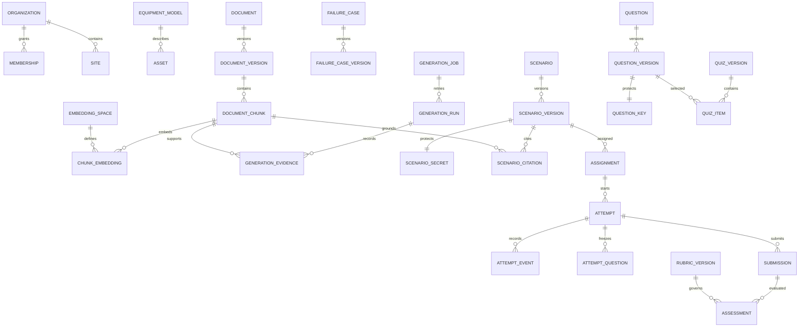

# PS015 upgraded data model

Design specification • 6 October 2026 • Proposed PostgreSQL model; not an executed migration

Read with [architecture](PS015-ARCHITECTURE.md) and [implementation plan](PS015-PROTOTYPE-PLAN.md). Table names below describe the target model. Map them to the actual application only after recovering its ORM and migration files.

## 1. Common rules

- Use UUID identifiers, `timestamptz` server timestamps, `bigint` event sequences/revisions and explicit enum/check constraints. Use bounded text and `numeric` where exact rubric arithmetic matters.
- Every tenant-owned table has non-null `organization_id`. Give referenced tenant rows `UNIQUE(organization_id, id)` and use composite foreign keys so a row cannot reference another tenant's object accidentally. Membership and site grants remain separate authorization checks.
- Maintain `schema_version` for JSON payloads. JSONB stores bounded nested content such as a component graph, not unindexed identities, permissions or lifecycle state.
- Immutable version rows have parent identity, version number, content hash, creator, creation time and superseded/deprecated metadata. Freeze published payloads, source provenance, answer keys and grading policy through service authorization plus database enforcement.
- Keep authoring drafts and published versions separate. Mutable review status does not grant permission to edit an already released payload.
- References in JSON must be checked by the server. Promote relationships that require referential integrity into relational link tables.

## 2. Entity relationship view



The diagram omits repeated tenant FKs and secondary join tables for clarity. The catalog below specifies those additional relationships.

## 3. Identity and equipment

| Entity | Important fields | Constraints / purpose |
|---|---|---|
| `organization` | `id`, `name`, `status`, `retention_policy_version` | Security and operational boundary |
| `user` | `id`, external identity or credential reference, display name, status | Global identity; no global instructor role implicitly grants every organization |
| `membership` | organization/user, role, status | Unique organization/user; server validates active membership |
| `site` | organization, id, name, timezone | Stable site identity; timestamps stored in UTC |
| `site_grant` | organization/user/site, permission | Explicit instructor and learner site access |
| `equipment_type` | id, stable code | Motor, CNC, Compressor; extensible reference taxonomy |
| `equipment_model` | organization/id, type, manufacturer, model, revision, reviewed limits JSONB | Different model revisions may require different manuals and transitions |
| `asset` | organization/site/id, equipment_model_id, external asset key | Optional real or simulated instance; never implies machine-control access |
| `competency` | organization/id, code, description, curriculum_version | Reusable assessed learning objective |

Reference taxonomy may be global. Private equipment and curriculum are tenant-owned. Shared content is distributed through explicit read grants or copies with provenance, never `organization_id IS NULL` as an implicit authorization bypass.

## 4. Sources, retrieval and provenance

| Entity | Important fields | Constraints / purpose |
|---|---|---|
| `document` | organization/id, owner, source_type, title, rights_basis, external_inference_allowed, ACL epoch | Mutable identity/access metadata; permission is not inferred from upload |
| `document_version` | document FK, version, content_sha256, object_uri, MIME, extraction_version, ingestion_state, effective_date | Unique document/version; immutable content identity |
| `document_applicability` | document_version/equipment_model/site or explicit grant | Normalized scope; approved applicability must be present |
| `document_chunk` | version FK, ordinal, text, page_start/end, section_path, offsets, token_count, content_sha256, `tsvector` | Unique version/ordinal; retain enough location information to display/verify citations |
| `embedding_space` | id, provider, model_revision, tokenizer_revision, dimensions, metric, normalization, query_mode, passage_mode, index_generation | Defines a compatible vector space; equal dimensions alone do not imply compatibility |
| `chunk_embedding` | chunk/space FK, embedding, created_at | Unique chunk/space; fixed physical dimension per table/index generation |
| `generation_evidence` | run/chunk FK, rank, lexical_score, vector_distance, rerank_score, permission_snapshot_hash | Frozen evidence bundle; recheck current access before publishing |
| `scenario_citation` | scenario_version/chunk FK, claim_path, support_status, reviewer_id | Links a precise claim to evidence, beyond a decorative citation list |

For source revocation, deny future retrieval/download immediately; identify affected published scenarios through citation links and apply the organization's suspension/review policy. Historical records retain lawful provenance references while content access remains controlled.

### Semantic migration and indexing

Do not reuse 64-dimensional demo hashes as semantic embeddings. Create a new embedding space and physical vector table/index, embed approved chunks, compare against a frozen retrieval set, then switch a versioned retrieval configuration atomically. Retain the old index for rollback until retention permits removal.

Select the embedding model before choosing storage dimensions. For example, `vector(1024)` can support a compatible 1024-dimensional model; it is an example, not a universal NVIDIA embedding dimension. pgvector's documented HNSW limits include 2,000 dimensions for `vector` and 4,000 for `halfvec`. A 2048-dimensional model therefore needs a compatible representation/index strategy such as evaluated `halfvec(2048)` indexing, rather than blindly using HNSW on `vector(2048)`. Validate retrieval quality after precision changes. [pgvector reference](https://github.com/pgvector/pgvector#hnsw)

Use a GIN index for full-text search and appropriate B-tree scope indexes. Start with exact vector search on small authorized subsets; add HNSW when data volume warrants it. Authorization predicates remain inside every query. Approximate search may filter after candidate scanning and return too few matching rows; use scoped indexes/partitions or bounded iterative scans and measure recall against exact search. Never loosen tenant/equipment/source filters to fill top-k. [Filtering behavior](https://github.com/pgvector/pgvector#filtering)

One possible reviewed migration fragment, assuming a compatible fixed 1024-dimensional space and matching table definitions:

```sql
CREATE INDEX chunks_version_ordinal
  ON document_chunk (organization_id, document_version_id, ordinal);
CREATE INDEX chunks_fts ON document_chunk USING gin (search_vector);
CREATE INDEX embeddings_space_chunk
  ON chunk_embedding_1024 (organization_id, embedding_space_id, chunk_id);
-- A separate table/index generation contains one compatible embedding space.
CREATE INDEX embeddings_cosine
  ON chunk_embedding_1024 USING hnsw (embedding vector_cosine_ops);
```

This is an index illustration, not standalone DDL. Production large-index creation, lock budgets and transaction handling require migration-specific review.

## 5. Models and generation

| Entity | Important fields | Constraints / purpose |
|---|---|---|
| `model_version` | id, task, repository, immutable revision, artifact_sha256, tokenizer_revision, license_reference, eval_release_id | Distinguish LLM, embedding, reranker and detector models |
| `deployment_version` | model FK, image_digest, backend/version, profile_id, precision, GPU model/count, runtime configuration hash | Actual serving configuration, not just model name |
| `prompt_version` | id, template, template_hash, output_contract_version | Versioned template; no credentials |
| `generation_job` | organization/id, requester, idempotency_key, request_hash, status, priority, available_at, lease_token, leased_until, retry_count, max_retries | Unique organization/requester/key; a reused key with a different request hash is a conflict |
| `generation_job_source` | job/document_version | Pins selected authorized sources before claim |
| `generation_run` | job, run_number, deployment/prompt/retrieval config, parameters, seed, input/output token counts, timings, failure_code, accepted_output_hash | Unique job/run; retries remain visible; seed does not promise deterministic text |
| `validation_result` | run, validator_version, check_name, passed, bounded details | Distinguish structural, evidence, graph, leakage and reviewer checks |
| `review_decision` | draft/content_hash, reviewer, decision, rubric/checklist version, timestamp | Approval bound to exact content, not just mutable draft ID |
| `outbox_event` | organization/id, aggregate_type/id, aggregate_revision, event_type/version, payload, created_at, published_at | Durable delivery intent committed with business changes |

Job lifecycle: `queued → running → succeeded | failed | cancelled`; transient failures may move back to queued with bounded backoff. Each claim has a fresh token. Heartbeat/complete only where token and status still match. A stale worker must not commit its output. Cancellation and completion race through one conditional database transition. Persist a draft and job success atomically.

Use a partial claim index on eligible jobs, for example `(priority DESC, available_at, id) WHERE status='queued'`, plus organization/requester/status indexes for quotas. Add a leased-until index for expired running jobs. Ensure a tenant cannot monopolize all workers; quotas and fair selection apply separately from job priority.

## 6. Scenario and quiz releases

| Entity | Important fields | Constraints / purpose |
|---|---|---|
| `failure_case` / `failure_case_version` | equipment applicability, fault taxonomy, symptoms, competing causes, distinguishing evidence, approved action model, sources | Instructor knowledge library; versioned expertise |
| `scenario` | organization/id, stable catalog identity | Identity across revisions |
| `scenario_draft` | organization/id, generation_run, editable payload, revision | Mutable authoring with optimistic concurrency |
| `scenario_version` | scenario/version, equipment_model, failure_case_version, title, difficulty, objectives, public brief, public action descriptors, graph_version, engine_version, content_hash | Unique scenario/version; neutral trainee title; immutable release |
| `scenario_secret` | scenario_version PK/FK, true cause, private observations, transitions, solution, answer rationale | Separate restricted relation; never serialized to trainee |
| `scenario_competency` | scenario_version/competency, expected proficiency | Enables coverage checks |
| `rubric_version` | rubric identity/version, criteria, weights, pass threshold, mandatory gates, scoring_engine_version | Weight sum validated transactionally; immutable |
| `question` / `question_version` | type, prompt, public option IDs/text, difficulty, equipment scope, competency links, provenance, content_hash | Immutable reviewed question versions |
| `question_key` | question_version PK/FK, correct option IDs/order, scoring details, explanation | Server/instructor access only; options validated against public question |
| `quiz_version` / `quiz_item` | quiz/version, question_version, position, points | Unique quiz/position and quiz/question; no accidental duplicates |
| `publication` | scenario_version, quiz_version, rubric_version, reviewer, approval_hash, published_at, active/deprecated status | All referenced versions approved; publication is one transaction |

Use relation-level database grants for private answer tables in addition to API projections. If the same API service can read secrets for grading, isolate grading functions and response schemas; RLS alone does not prevent a buggy serializer from exposing a permitted secret.

### Example scenario contract

Illustrative instructor-only draft, abbreviated to two actions and one question. These symbolic IDs refer to future fixtures; this example is not a production-valid five-step release or evidence of an actual manual.

```json
{
  "schema_version": "scenario-draft/1.0",
  "equipment_model_id": "motor-demo-model-v1",
  "difficulty": "beginner",
  "competency_ids": ["interpret-condition-evidence"],
  "public": {
    "title": "Investigate abnormal motor vibration",
    "brief": "Review the simulated evidence and distinguish possible causes.",
    "actions": [
      {"id": "review_safety", "label": "Review the approved safety checklist"},
      {"id": "inspect_recorded_measurements", "label": "Inspect recorded condition measurements"}
    ]
  },
  "private": {
    "failure_case_version_id": "bearing-case-v1",
    "initial_state": "awaiting_safety_review",
    "transitions": [
      {"from": "awaiting_safety_review", "action": "review_safety", "to": "ready_for_evidence"},
      {"from": "ready_for_evidence", "action": "inspect_recorded_measurements", "to": "evidence_collected"}
    ],
    "terminal_states": ["evidence_collected"],
    "reference_diagnosis": "bearing_degradation"
  },
  "questions": [{
    "id": "q1",
    "type": "single_choice",
    "prompt": "Which approach best supports a defensible diagnosis?",
    "options": [
      {"id": "a", "text": "Use the first symptom as the final diagnosis"},
      {"id": "b", "text": "Compare collected evidence against plausible causes"},
      {"id": "c", "text": "Assume every vibration case has the same cause"}
    ],
    "private_key": {"correct_option_id": "b"}
  }],
  "citations": [{"claim_path": "/questions/0", "chunk_id": "approved-training-guide-chunk-12"}]
}
```

Use separate request/response types for instructor drafts, trainee scenarios, current state and post-submission results. `additionalProperties: false` at every defined object level, bounded arrays/strings and enums reject unexpected fields. References, graph reachability, single-answer consistency and equipment compatibility require semantic validation beyond JSON Schema.

## 7. Training and scoring

| Entity | Important fields | Constraints / purpose |
|---|---|---|
| `assignment` | organization, instructor, publication/version IDs, cohort, open/close time, feedback_policy | Pins scenario/quiz/rubric; cohort membership controls access |
| `assignment_member` | assignment/user | Unique assignment/user |
| `attempt` | assignment/user, seed, engine_version, revision, status, current_state JSONB, state_hash, started/completed_at | Unique attempt number per assignment/user; one active attempt if policy requires |
| `attempt_question` | attempt/question_version, displayed option-ID order, max_points | Freeze exactly what was presented |
| `attempt_event` | attempt, sequence, action_id, idempotency_key, request_hash, expected/result_revision, event_type/version, recorded_at, observation references, state hash | Unique attempt/sequence and attempt/key; append-only |
| `attempt_checkpoint` | attempt/revision, snapshot, hash, engine_version | Optional later optimization; pilot may retain each event snapshot |
| `submission` | attempt, submission_number, idempotency_key, request_hash, submitted_answers, diagnosis, server_time | Policy defines permitted submissions; default one final submission per attempt |
| `assessment` | submission, revision, rubric_version, scoring_engine_version, components, total, outcome, evidence_digest | Immutable result; corrections create an explicit revision with reason/reviewer |
| `audit_event` | organization, actor, action, target, server_time, trace_id, before/after hashes | Restricted, privacy-aware administrative audit |

### Atomic action algorithm

1. Authenticate, validate membership and assignment authorization, then validate a bounded request containing action ID, expected revision and idempotency key.
2. Begin a short transaction. Lock the authorized attempt row. Look up the idempotency key; return the stored response if the request hash matches, otherwise reject.
3. Verify status and expected revision. Compute the allowed transition using the pinned engine, current state, recorded seed and approved observation data.
4. Update the state/revision, append one event and insert an outbox row in the same transaction. Uniqueness checks defend against duplicate actions.
5. Commit before sending a response or stream notification. A retry after a lost response returns the same committed result. A stale revision returns HTTP 409 with a safe current revision reference.

The engine owns time semantics: persist simulation time separately from server receipt time. For reproducible stochastic behavior record PRNG algorithm/version and state or draw position, not only an initial seed. Persist nondeterministic external observations that affected transitions. Canonicalize numeric rounding/JSON hashing per engine version. A state hash detects unexpected changes; it is not proof against a privileged database administrator.

Index `(organization_id, learner_id, started_at DESC, id)` for attempt lists, `(organization_id, assignment_id, status)` for instructor views and `(organization_id, attempt_id, sequence)` for replay. Use keyset pagination for large histories. Do not run unbounded event replay on every state read; current snapshots serve ordinary reads, while submission/integrity checks use the recorded history or verified checkpoints.

At small volume retain unpartitioned attempt events for simple global uniqueness. If later time partitioning is needed, PostgreSQL unique constraints must include partition keys or use a separate deduplication registry; preserve attempt/sequence and idempotency guarantees explicitly. Do not add a time partition and assume the old uniqueness contract survives unchanged.

## 8. Telemetry and detector contracts

`telemetry_batch`: organization, asset/simulated_asset ID, producer/session ID, source type (`synthetic`, `recorded`, `live`), schema version, first/last source time, received time, sequence bounds, channel definitions, units, sample rate when known, quality flags, payload URI and checksum.

`observation`: organization, scenario/attempt context, batch/range reference, channel, value/features, units, source time, quality, model_prediction reference. Unknown sample rate/unit stays unknown; do not fabricate metadata.

`model_prediction`: model/deployment version, input artifact hash/window, output label/value, uncertainty method/value when calibrated, dataset/domain identity, release status and inference timing. A classifier score is not automatically a calibrated probability.

For real streaming, deduplicate by organization + producer/session + event ID; order within source keys and bound out-of-order lateness. Keep raw high-frequency points outside `attempt_event`. Record the exact evidence window shown in the learner session so later replay is stable.

## 9. Tenant enforcement and migration invariants

Derive effective organization/user scope from the authenticated principal. Set database context locally inside each transaction and reset it through transaction completion. Use non-owner application roles without `BYPASSRLS`; enable and force RLS where appropriate, with both `USING` and `WITH CHECK` rules. Worker jobs receive validated tenant scope and must pass the same checks. Test pooled-connection scope reuse. Global administrative functions require explicit audited paths.

Do not treat a tenant filter as site authorization. Join current membership/site/source grants or use reviewed policies; tests must cover removed grants, revoked documents, instructor ownership and cross-tenant FKs. A user-controlled PostgreSQL setting is not an independent security boundary if arbitrary SQL is exposed; keep parameterized queries and restricted database access.

Use expand/backfill/validate/switch/contract migrations: map existing owners to organizations deliberately, quarantine ambiguous mappings, preserve old scenario/engine/history IDs, build new semantic indexes in parallel, then enable stricter constraints and switch reads. Never create a universal default tenant that exposes unrelated accounts. Do not overwrite published payloads, historical grades or audit hashes during backfill.
